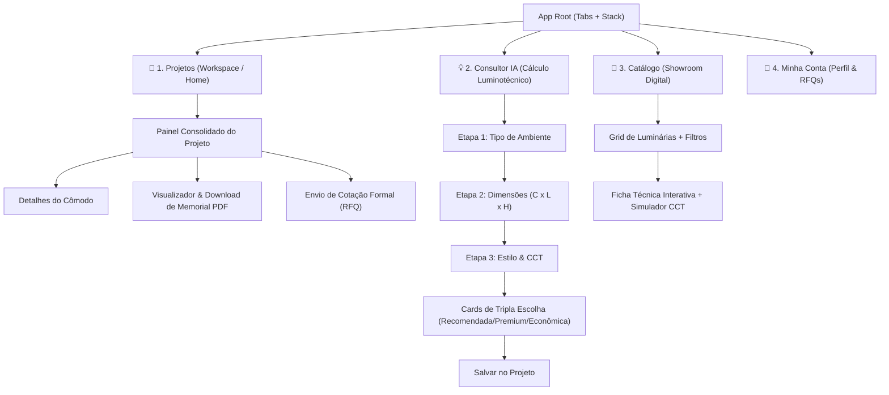

# QLS Lighting App — Especificação Completa de Design & UI/UX

**Status:** Aprovado e Consolidado via `/grill-me`  
**Base Visual:** QLS Design System (`QLS-Design-System-Son-Med.html`)  
**Plataforma:** React Native / Expo Mobile (iOS & Android) + NativeWind (Tailwind CSS)  
**Data:** 2026-10-08  

---

## 1. Fundamentos Visuais & Design Tokens

### 1.1 Tipografia (Urbanist)
O aplicativo adota a família tipográfica oficial **Urbanist** com tracking negativo suave para transmitir elegância e precisão técnica.

| Nível | Família & Peso | Tamanho | Line Height | Tracking | Aplicação |
| :--- | :--- | :--- | :--- | :--- | :--- |
| **Display / Hero** | Urbanist Bold (700) | 36px – 42px | 1.1 | -0.04em | Títulos de boas-vindas, destaques de valor |
| **H1 (Header)** | Urbanist Bold (700) | 28px – 32px | 1.15 | -0.03em | Títulos de tela principal, Nome do Projeto |
| **H2 (Seção)** | Urbanist SemiBold (600) | 22px – 24px | 1.2 | -0.02em | Títulos de seções, Cards de KPIs |
| **H3 (Subseção)** | Urbanist SemiBold (600) | 18px – 20px | 1.25 | -0.01em | Nomes de luminárias, Nomes dos cômodos |
| **Body (Padrão)** | Urbanist Regular (400) | 15px – 16px | 1.5 | Normal | Textos descritivos, dados técnicos |
| **Body Medium** | Urbanist Medium (500) | 14px – 15px | 1.4 | Normal | Rótulos de formulário, valores numéricos |
| **Caption / Badge** | Urbanist SemiBold (600) | 12px – 13px | 1.3 | +0.02em | Badges de norma (AS/NZS), CCT (3000K), IRC |

---

### 1.2 Paleta de Cores (Tokens QLS)

```json
{
  "colors": {
    "qls-black": "#0a0a0a",
    "qls-ink": "#1a1814",
    "qls-dark": "#3a3632",
    "qls-grey": "#6f6a64",
    "qls-mute": "#9a9590",
    "qls-line": "#3a3632",
    "qls-light": "#e4e0da",
    "qls-off": "#181715",
    "qls-white": "#f8f6f2",
    "gold": {
      "DEFAULT": "#c9a84c",
      "dark": "#a8843a",
      "light": "#e8b86a",
      "glow": "rgba(201, 168, 76, 0.25)"
    },
    "semantic": {
      "ok": "#3f7a4f",
      "warn": "#b7791f",
      "err": "#b3382c",
      "info": "#2f5d8a"
    }
  }
}
```

---

### 1.3 Raios de Borda (Radius) & Efeitos de Elevação
* **Raio Pequeno (`r-s`):** `8px` (Inputs, botões secundários, badges)
* **Raio Médio (`r-m`):** `16px` (Cards de produto, containers de cômodos, modais)
* **Raio Pílula (`r-p`):** `9999px` (Botões de ação primária, tags de status, tabs de filtro)
* **Efeito Glow de Iluminação:**
  * Card com efeito feixe de luz: `radial-gradient(circle at 50% 30%, rgba(232,184,106,0.3) 0%, rgba(168,132,58,0.15) 50%, #0a0a0a 90%)`.
  * Borda ativa: `border: 1.5px solid #c9a84c` com sombra dourada difusa.

---

## 2. Arquitetura de Navegação (Navigation Shell)



---

## 3. Especificação Detalhada das Telas (UI & Interações)

### 3.1 Aba 1: Projetos / Home (Workspace)
* **Header:** Logo QLS em acabamento horizontal, saudação personalizada e botão de busca rápida.
* **Seção de Ação Rápida:** Card de destaque com gradiente dourado e botão `+ Criar Novo Projeto`.
* **Lista de Projetos Recentes:** Cards elegantes contendo:
  * Nome do Projeto (ex: *Residência Mosman - Sydney*).
  * Quantidade de Cômodos cadastrados (ex: *4 cômodos*).
  * Total de Luminárias especificadas (ex: *28 peças*).
  * Status (Em elaboração, RFQ Enviado, Proposta Pronta).
  * Data da última atualização.

---

### 3.2 Aba 2: Consultor Luminotécnico com IA (Wizard 3 Etapas)

1. **Etapa 1: Seleção do Tipo de Ambiente**
   * Grid de cards visuais com ícones e fotos estilizadas em tons escuros:
     * Cozinha / Gourmet (Norma AS/NZS: 240–300 Lux)
     * Sala de Estar / Jantar (Norma AS/NZS: 150–200 Lux)
     * Dormitório / Suíte (Norma AS/NZS: 100–150 Lux)
     * Home Office / Estudo (Norma AS/NZS: 320–500 Lux, $UGR < 19$)
     * Banheiro / Lavabo (Norma AS/NZS: 200–300 Lux, $IP44/IP65$)
     * Área Externa / Varanda (Norma AS/NZS: 100–150 Lux, $IP65$)

2. **Etapa 2: Dimensões Táteis & Metas em Tempo Real**
   * Controles táteis e inputs com feedback numérico:
     * Comprimento ($m$) e Largura ($m$) $\rightarrow$ Área calculada dinamicamente ($m^2$).
     * Altura do Pé-direito ($m$) $\rightarrow$ Ajuste de iluminância e fator de utilização.
     * Tipo de Teto/Forro (Gesso/Drywall, Concreto Aparente, Madeira).
   * Badge em tempo real exibindo a meta de Lux calculada de acordo com as normas australianas.

3. **Etapa 3: Estilo de Luz e Temperatura de Cor (CCT)**
   * Seletor de botões de pílula com pré-visualização cromática:
     * **2700K (Warm White):** Aconchego e relaxamento.
     * **3000K (Soft White):** Equilíbrio residencial refinado (Padrão recomendado).
     * **4000K (Neutral White):** Produtividade, foco e fidelidade de cores em bancadas.

4. **Tela de Resultados: Tripla Escolha com Efeito Glow**
   * **Opção 1: Recomendada (Best Match):** Destaque com borda dourada e badge `RECOMENDADA PELA IA`.
   * **Opção 2: Premium (Architectural Luxury):** Foco em alto IRC ($>95$), acabamento em latão/ouro e ótica antiofuscante.
   * **Opção 3: Econômica (Cost-Effective):** Foco em excelente relação custo-benefício e alta eficiência energética ($lm/W$).
   * Cada card exibe:
     * Imagem do produto sobre fundo radial de iluminação.
     * Quantidade calculada para o ambiente (ex: `4x Luminárias`).
     * Nível de iluminância atingido (ex: `285 Lux` — *100% em conformidade com AS/NZS 1680*).
     * Seletor de acabamento (Preto Fosco, Branco Texturizado, Latão Escovado).
     * Botão `Adicionar ao Projeto`.

---

### 3.3 Painel Consolidado do Projeto & Proposta PDF / RFQ
* **Header Executivo:** Nome do Projeto, Endereço/Cliente, Botão de Edição.
* **Barra de KPIs:** 3 cards com números de impacto:
  * Total de Luminárias (ex: `34 Peças`).
  * Potência Instalada Total (ex: `380 W`).
  * Consumo Médio por $m^2$ (ex: `4.8 W/m²` — *Alta Eficiência Energética*).
* **Lista de Cômodos (Acordeão):**
  * Cada linha exibe o cômodo, foto da luminária selecionada, quantidade e botão de editar ou excluir.
* **Ações de Rodapé:**
  * Botão Primário Dourado: `Solicitar Cotação Oficial (RFQ)` $\rightarrow$ Envia para o comercial da fábrica e salva no Supabase.
  * Botão Secundário Outline: `Gerar Memorial Técnico (PDF)` $\rightarrow$ Renderiza na hora o PDF formal pronto para impressão ou envio ao cliente.

---

### 3.4 Aba 3: Showroom & Catálogo Digital
* **Barra Superior de Filtros:** Pílulas deslizantes: `Todos`, `Downlights`, `Pendentes`, `Perfis LED`, `Trilhos Magnéticos`, `Arandelas`, `Externo`.
* **Grid de Produtos:** 2 colunas com imagem sobre glow suave, nome, potência em Watts, fluxo em Lúmens e badge de IRC.
* **Página de Detalhes da Luminária:**
  * Carrossel de fotos em alta resolução.
  * Seletor interativo de CCT que ilumina a cena na tela conforme a temperatura escolhida (2700K / 3000K / 4000K).
  * Ficha técnica com tabela de especificações (Dimensões de corte, Ângulo de facho, Grau IP, UGR, Vida útil L80B10).
  * Botão para download de arquivos IES / BIM / DWG para arquitetos.
  * Botão fixo no rodapé: `Adicionar a um Projeto Existente`.

---

### 3.5 Aba 4: Minha Conta, Perfil B2B & Rastreamento de RFQs
* **Header de Perfil:** Nome do usuário, Empresa / Estúdio de Arquitetura, Tipo de Conta (Especificador B2B / Cliente Final).
* **Linha do Tempo de Orçamentos (RFQ Tracking):**
  * Card para cada cotação enviada com visualizador de etapas:
    1. *Cotação Recebida pela Fábrica*
    2. *Análise de Estoque & Engenharia*
    3. *Proposta Comercial Pronta com Preços Especiais*
    4. *Pedido Confirmado / Despachado*
* **Atendimento Exclusivo:** Botão direto com link para suporte técnico e comercial via WhatsApp e Telefone da fábrica.

---

## 4. Feedback Tátil (Haptics) & Microinterações
* **Seleção de Cards e Opções:** Haptic leve (`impactLight`) ao tocar em cards de luminárias e botões de acabamento.
* **Sliders de Dimensões:** Haptic de clique suave a cada incremento inteiro de metro.
* **Conclusão de Cálculo:** Haptic de sucesso (`notificationSuccess`) com animação sutil de brilho no card recomendado.
* **Troca de Temperatura (Kelvin):** Transição suave de cor do fundo da imagem simulando a luz acendendo.
