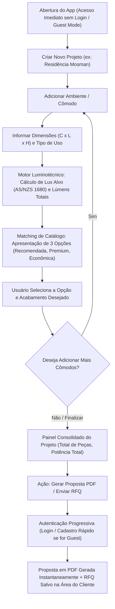
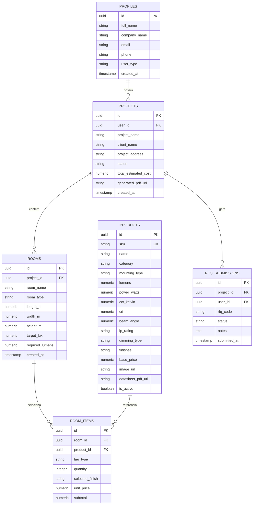

# Especificação Completa do Produto: Consultor Luminotécnico com IA (QLS Lighting App)

**Status:** Especificação Consolidada (Pós-Grilling)  
**Mercado-Alvo:** Austrália (Modelo B2B/B2C RFQ - *Request for Quote*)  
**Plataformas:** Mobile iOS e Android (React Native / Expo)  
**Backend & DB:** Supabase (PostgreSQL, Auth, Edge Functions, Storage)  
**Última Atualização:** 2026-10-08

---

## 1. Visão Geral e Proposta de Valor
Aplicativo mobile oficial de uma fábrica de iluminação australiana que atua como um **consultor luminotécnico inteligente** e catálogo digital de alta conversão.

O aplicativo elimina gargalos no processo de especificação técnica e orçamentos: o usuário (especificador B2B ou cliente final com projeto) cadastra seus projetos, insere as medidas dos ambientes e requisitos desejados, e o motor de IA calcula a iluminância conforme as normas australianas (**AS/NZS 1680**), dimensiona a quantidade de peças e recomenda o produto ideal do catálogo da fábrica, junto com 2 opções alternativas (Premium e Econômica).

Ao finalizar, o sistema consolida o projeto completo em um **Memorial Descritivo e Proposta Formal em PDF** e registra o pedido de cotação (**RFQ**) direto na Área do Cliente e no sistema comercial da fábrica.

---

## 2. Perfis de Usuário (Público-Alvo)

1. **Especificadores B2B (Lighting Designers, Arquitetos, Eletricistas, Construtores):**
   - Criação ágil de projetos com múltiplos cômodos direto no canteiro de obras ou reuniões.
   - Geração instantânea de PDF profissional com quantitativo (BOM), especificações de lúmens/IRC/facho e fichas técnicas para anexar aos projetos executivos.

2. **Clientes Finais / B2C (com medidas do projeto):**
   - Inserção amigável de medidas e intenção de uso do ambiente.
   - Tradução automática de termos cotidianos para parâmetros técnicos de iluminação sem ruídos de comunicação.

---

## 3. Jornada do Usuário & Fluxos de Tela (Core UX)

---

## 4. Motor de IA & Cálculo Luminotécnico

### 4.1 Normas de Iluminância Aplicadas (AS/NZS 1680)
O sistema aplica os níveis de iluminância recomendados pelas normas australianas para cada tipo de ambiente:
* **Cozinhas e Áreas Gourmet:** 240 – 300 lux ($IRC \ge 80/90$)
* **Salas de Estar / Jantar:** 150 – 200 lux (2700K – 3000K)
* **Quartos / Dormitórios:** 100 – 150 lux (Luz quente / Conforto visual)
* **Home Office / Escritórios:** 320 – 500 lux ($UGR < 19$, 4000K neutro)
* **Banheiros / Lavabos:** 200 – 300 lux (Área do espelho/bancada: 400 lux, IP44/IP65)
* **Áreas Externas / Varandas:** 100 – 150 lux ($IP65/IP67$)

### 4.2 Fórmulas de Dimensionamento
1. **Área do Ambiente ($m^2$):** $A = C \times L$
2. **Índice do Recinto ($K$):** $K = \frac{C \times L}{h_{util} \times (C + L)}$
3. **Fluxo Luminoso Total ($\Phi_{total}$ em Lúmens):**
   $$\Phi_{total} = \frac{E_{alvo} \times A}{\mu \times d}$$
   *(onde $\mu \approx 0.60$ a $0.75$ é o fator de utilização e $d \approx 0.80$ é o fator de manutenção/depreciação).*
4. **Cálculo da Quantidade de Luminárias ($N$):**
   $$N = \left\lceil \frac{\Phi_{total}}{\text{Fluxo por Peça do SKU}} \right\rceil$$

---

## 5. Estrutura do Banco de Dados (Supabase / PostgreSQL)

---

## 6. Registro Completo de Decisões de Arquitetura (ADRs)

* **ADR-001 (Catálogo da Fábrica):** Catálogo indexado e gerenciado via Supabase PostgreSQL, importado a partir das planilhas CSV/Excel da fábrica, com upload de datasheets em PDF para o Supabase Storage.
* **ADR-002 (Cálculo Luminotécnico Determinístico):** Quantidades e lúmens calculados deterministicamente pelo algoritmo luminotécnico calibrado pelas normas AS/NZS 1680, com assistência de IA para refinamento contextual.
* **ADR-003 (Entrada Estruturada de Medidas):** Entrada direta de medidas reais de projeto ($C \times L \times H$) por ambiente, evitando inconsistências de OCR.
* **ADR-004 (Modelo Comercial Australiano - RFQ):** Plataforma focada em geração de proposta e orçamento formal sem transação de checkout de varejo.
* **ADR-005 (Estrutura de Projeto Multi-Ambientes):** Projetos organizados por múltiplos cômodos com consolidação de lista de compras e memorial único.
* **ADR-006 (Recomendação Tripla por Ambiente):** Apresentação da Opção Recomendada + 2 Alternativas (Premium / Alto Conforto e Econômica).
* **ADR-007 (Plataforma Mobile iOS / Android):** Construído em **React Native com Expo Router** para experiência fluida nativa em iOS e Android.
* **ADR-008 (Progressive Profiling / Guest-First):** Criação e cálculo livres sem bloqueio de login; autenticação solicitada apenas ao gerar PDF, salvar projeto ou enviar RFQ.
* **ADR-009 (Backend & Storage Supabase):** PostgreSQL com Row Level Security (RLS), Supabase Auth para controle de acesso e Supabase Storage para armazenamento seguro de PDFs e imagens.
* **ADR-010 (Branding Oficial da Fábrica):** Identidade visual, tipografia e paleta de cores proprietárias da fabricante australiana.
