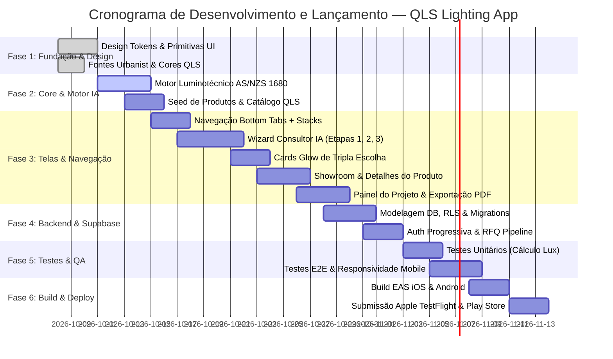
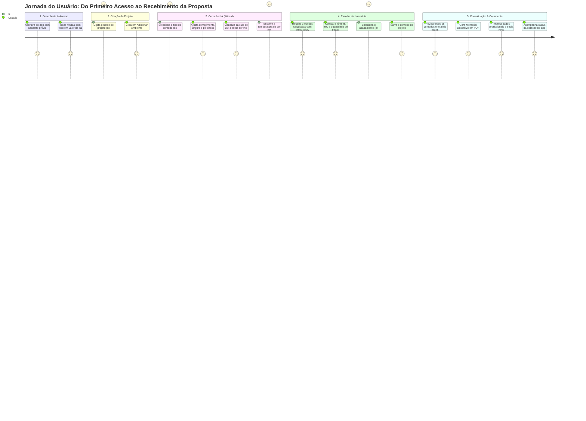

# QLS Lighting App — Roadmap, Jornada do Usuário & Wireframes de Todas as Telas

**Documento Oficial de Engenharia e Design**  
**Versão:** 1.0  
**Data:** 2026-10-08  
**Stack Técnica:** React Native / Expo (SDK 52+), TypeScript, NativeWind (Tailwind CSS v4), Supabase (PostgreSQL, Auth, Storage, Edge Functions), Expo Print / Sharing.

---

# PARTE 1: ROADMAP COMPLETO DE CRIAÇÃO, TESTE E IMPLEMENTAÇÃO



### Detalhamento das Etapas de Engenharia

#### **Fase 1: Fundação, Tokens e Componentes Base (UI Primitives)**
* [x] Configuração dos tokens no `tailwind.config.js` (Cores QLS: `#0a0a0a`, `#c9a84c`, `#1a1814`, `#f8f6f2`).
* [x] Carregamento da fonte `Urbanist` (pesos 300 a 700).
* [ ] Criação dos componentes atômicos:
  * `Button` (Pílula: Primário Black, Dourado, Outline, Ghost).
  * `Input` & `Slider` (Borda com anel de foco dourado).
  * `GlowCard` (Container com gradiente radial simulando feixe de luz).
  * `Badge` & `Tag` (Conformidade AS/NZS, IRC, CCT).
  * `Stepper` (Indicador linear de progresso 1-2-3).

#### **Fase 2: Motor de Cálculo Luminotécnico & Regras AS/NZS 1680**
* [ ] Implementação do módulo `src/services/lightingEngine.ts`:
  * Fórmulas de área ($A = C \times L$) e índice do recinto ($K$).
  * Cálculo de lúmens necessários ($\Phi_{total} = \frac{E_{alvo} \times A}{\mu \times d}$).
  * Algoritmo de dimensionamento da quantidade de peças ($N$).
  * Lógica de recomendação: **Melhor Escolha**, **Opção Premium** e **Opção Econômica**.
* [ ] **Motor Multimodal de Visão com IA (Gemini 2.0 / 1.5 Flash):**
  * Leitura e extração de pranchas completas e cômodos individuais em PDF, PNG, JPG ou print.
  * Modo Projeto Luminotécnico (quantitativo e matching de catálogo QLS/LEDYi).
  * Modo Planta Arquitetônica (extração de cotas e cálculo fotométrico do zero).
  * Modal interativo de revisão e ajuste antes da consolidação no projeto.

#### **Fase 3: Construção das Telas e Fluxos de Navegação**
* [ ] Estrutura de Navegação com Expo Router ou React Navigation.
* [ ] Fluxo completo do Consultor (Wizard em 3 etapas táteis).
* [ ] Catálogo com filtro por aplicação e tela de produto com seletor interativo de Kelvin.
* [ ] Painel consolidado com soma de potência em Watts e botão de PDF.

#### **Fase 4: Backend Supabase & Geração de Memorial PDF**
* [ ] Banco de dados PostgreSQL com tabelas `profiles`, `projects`, `rooms`, `room_items`, `products`, `rfq_submissions`.
* [ ] Autenticação Guest-First com conversão para conta registrada no envio do RFQ.
* [ ] Edge Function / Gerador HTML-to-PDF com design editorial para o Memorial Descritivo.

#### **Fase 5: Suíte de Testes e Validação**
* [ ] **Testes Unitários (Jest):** Validação matemática de todas as fórmulas físicas de iluminância.
* [ ] **Testes de Integração:** Fluxo de criação de projeto $\rightarrow$ adição de múltiplos cômodos $\rightarrow$ geração de RFQ.
* [ ] **Testes em Dispositivos Físicos:** Validação de renderização de tela, tamanhos de toque (mínimo 48px), haptic feedback e safe areas (iPhone notch / Android gesture bar).

#### **Fase 6: Deploy & Lançamento**
* [ ] Configuração do `eas.json` para builds otimizados.
* [ ] Publicação do app no TestFlight (iOS) e Google Play Internal Testing (Android).

---

# PARTE 2: JORNADA DO USUÁRIO COMPLETA (END-TO-END USER JOURNEY)



---

# PARTE 3: WIREFRAMES ESTRUTURAIS DE TODAS AS TELAS

Abaixo estão os wireframes em alta fidelidade estrutural de cada tela do aplicativo, respeitando as safe areas, hierarquia e componentes do **QLS Design System**.

---

### Tela 1: Splash & Boas-Vindas (Entrada Imediata)
```text
+---------------------------------------------------+
|  [Status Bar: 09:41                    100% 🔋]   |
|                                                   |
|                                                   |
|                      [ QLS ]                      |
|            QUANTUM LIGHTING SOLUTIONS             |
|                                                   |
|                                                   |
|                 ✨ (Feixe de Luz Suave)            |
|                                                   |
|          "A QLS vende espaços agradáveis,         |
|                 não apenas LEDs."                 |
|                                                   |
|                                                   |
|                                                   |
|                                                   |
|    +-----------------------------------------+    |
|    |      [ Iniciar Consultor com IA ]       |    | -> Botão Primário Gold
|    +-----------------------------------------+    |
|                                                   |
|             [ Ver Catálogo de Produtos ]          | -> Botão Secundário Text
|                                                   |
|                                                   |
+---------------------------------------------------+
```

---

### Tela 2: Aba 1 — Workspace de Projetos (Home)
```text
+---------------------------------------------------+
| [ QLS ]                                 [ 🔔 ] [👤]|
|                                                   |
| Olá, Arquiteto!                                   |
| Seus Projetos Luminotécnicos                      |
|                                                   |
| +-----------------------------------------------+ |
| | ✨ NOVO PROJETO                               | |
| | Dimensionar iluminação para um novo espaço    | |
| | [+ Criar Projeto Rápido]                      | |
| +-----------------------------------------------+ |
|                                                   |
| PROJETOS RECENTES                        [Ver Todos]
|                                                   |
| +-----------------------------------------------+ |
| | 🏠 Residência Mosman (Sydney)                 | |
| | 📍 Mosman, NSW  •  Atualizado há 2h            | |
| | --------------------------------------------- | |
| | 4 Cômodos  •  28 Luminárias  •  340W Total     | |
| | [ Status: Cotação RFQ Enviada ] [ Badge Gold ]| |
| +-----------------------------------------------+ |
|                                                   |
| +-----------------------------------------------+ |
| | 🏢 Escritório Tech Hub - Nível 3              | |
| | 📍 Surry Hills  •  Atualizado ontem           | |
| | --------------------------------------------- | |
| | 6 Cômodos  •  52 Luminárias  •  580W Total     | |
| | [ Status: Em Elaboração ]       [ Badge Grey ]| |
| +-----------------------------------------------+ |
|                                                   |
|               ( + Botão Flutuante )               |
|                                                   |
| [📁 Projetos]  [💡 Consultor]  [📖 Catálogo]  [👤 Minha Conta] |
+---------------------------------------------------+
```

---

### Tela 3: Criar / Configurar Novo Projeto (Modal)
```text
+---------------------------------------------------+
| [x Fechar]                     Novo Projeto QLS   |
|---------------------------------------------------|
|                                                   |
| Nome do Projeto *                                 |
| [ Ex: Casa Alphaville / Apartamento 402         ] |
|                                                   |
| Endereço / Localização (Opcional)                 |
| [ Ex: Sydney, NSW                               ] |
|                                                   |
| Tipo de Edificação                                |
| ( ) Residencial    (•) Comercial    ( ) Corporativo|
|                                                   |
| Descrição / Notas do Projeto                      |
| [ Foco em iluminação aconchegante e dimerizável ] |
|                                                   |
|                                                   |
|                                                   |
|                                                   |
| +-----------------------------------------------+ |
| |       [ Continuar e Adicionar Cômodo -> ]     | |
| +-----------------------------------------------+ |
|                                                   |
+---------------------------------------------------+
```

---

### Tela 4: Consultor IA — Etapa 1: Seleção do Tipo de Ambiente
```text
+---------------------------------------------------+
| [<- Voltar]       Consultor IA • Passo 1 de 3     |
| [====== Etapa 1 ======] [ Etapa 2 ] [ Etapa 3 ]    |
|---------------------------------------------------|
|                                                   |
| Qual ambiente você deseja iluminar?               |
| Selecione o espaço para aplicarmos a norma AS/NZS |
|                                                   |
| +---------------------+   +---------------------+ |
| | 🍳                  |   | 🛋️                  | |
| | Cozinha / Gourmet   |   | Sala de Estar       | |
| | Meta: 240-300 Lux   |   | Meta: 150-200 Lux   | |
| +---------------------+   +---------------------+ |
|                                                   |
| +---------------------+   +---------------------+ |
| | 🛏️                  |   | 💻                  | |
| | Dormitório / Suíte  |   | Home Office / Estudo| |
| | Meta: 100-150 Lux   |   | Meta: 320-500 Lux   | |
| +---------------------+   +---------------------+ |
|                                                   |
| +---------------------+   +---------------------+ |
| | 🚿                  |   | 🌿                  | |
| | Banheiro / Lavabo   |   | Área Externa / Deck | |
| | Meta: 200-300 Lux   |   | Meta: 100-150 Lux   | |
| +---------------------+   +---------------------+ |
|                                                   |
| +-----------------------------------------------+ |
| |             [ Avançar para Dimensões -> ]     | |
| +-----------------------------------------------+ |
|                                                   |
+---------------------------------------------------+
```

---

### Tela 5: Consultor IA — Etapa 2: Dimensões Táteis & Metas ao Vivo
```text
+---------------------------------------------------+
| [<- Voltar]       Consultor IA • Passo 2 de 3     |
| [====== Etapa 1 ======] [====== Etapa 2 ======]   |
|---------------------------------------------------|
|                                                   |
| Dimensões do Cômodo: Cozinha
+-----------------------------------------------+
|    [ 📸 Escanear Cômodo com IA (Foto/PDF) ]    |
+-----------------------------------------------+
Ou informe manualmente:                      |
|                                                   |
| Comprimento (C)                     [ 4.50 m ]    |
| [----o---------------------------------------]    |
|                                                   |
| Largura (L)                         [ 3.20 m ]    |
| [-------o------------------------------------]    |
|                                                   |
| Altura do Pé-Direito (H)            [ 2.80 m ]    |
| [---o----------------------------------------]    |
|                                                   |
| +-----------------------------------------------+ |
| | 📊 CÁLCULO PRELIMINAR EM TEMPO REAL:          | |
| | • Área Total: 14.40 m²                        | |
| | • Meta Norma AS/NZS 1680: 300 Lux             | |
| | • Fluxo Total Necessário: ~6.000 Lúmens       | |
| +-----------------------------------------------+ |
|                                                   |
| Tipo de Teto:                                     |
| [• Gesso/Drywall ] [ Madeira ] [ Concreto/Laje ]  |
|                                                   |
| +-----------------------------------------------+ |
| |            [ Avançar para Estilo de Luz -> ]  | |
| +-----------------------------------------------+ |
|                                                   |
+---------------------------------------------------+
```

---

### Tela 6: Consultor IA — Etapa 3: Estilo & Temperatura de Cor (CCT)
```text
+---------------------------------------------------+
| [<- Voltar]       Consultor IA • Passo 3 de 3     |
| [====== Etapa 1 ======] [====== Etapa 2 ======] [====== Etapa 3 ======]|
|---------------------------------------------------|
|                                                   |
| Escolha a Temperatura de Cor (Kelvin)             |
|                                                   |
| +-----------------------------------------------+ |
| | (•) 3000K — Warm White (Conforto Elegante)    | |
| | ✨ Tom suave e convidativo. Padrão QLS.       | |
| +-----------------------------------------------+ |
|                                                   |
| +-----------------------------------------------+ |
| | ( ) 2700K — Ultra Warm (Relaxamento / Acolhedor)| |
| | ✨ Luz intimista dourada, ideal para suítes.  | |
| +-----------------------------------------------+ |
|                                                   |
| +-----------------------------------------------+ |
| | ( ) 4000K — Neutral White (Foco e Bancadas)   | |
| | ✨ Alta precisão e fidelidade visual em tarefas| |
| +-----------------------------------------------+ |
|                                                   |
| Exigência Especial:                               |
| [x] Alto Conforto Visual (UGR < 19 Antiglare)     |
| [ ] Proteção contra Umidade (IP44/IP65)           |
|                                                   |
| +-----------------------------------------------+ |
| |          [ ✨ Calcular Iluminação com IA ]    | |
| +-----------------------------------------------+ |
|                                                   |
+---------------------------------------------------+
```

---

### Tela 7: Resultados & Recomendações — Tripla Escolha com Glow
```text
+---------------------------------------------------+
| [<- Voltar]     Resultado para: Cozinha           |
| Área: 14.4m²  •  Meta: 300 Lux (AS/NZS 1680)      |
|---------------------------------------------------|
|                                                   |
|   [⭐ RECOMENDADA]    [ 💎 PREMIUM ]   [ 💰 ECONÔMICA ]  |
|                                                   |
| +-----------------------------------------------+ |
| |  [ BADGE: IA BEST MATCH ]                     | |
| |                                               | |
| |               / \   (Glow Dourado)            | |
| |              / O \  Foto Luminária            | |
| |             /=====\                           | |
| |                                               | |
| |  AURORA DEEP ARCHITECTURAL DOWNLIGHT          | |
| |  Quantidade Calculada: 6x Peças               | |
| |  -------------------------------------------- | |
| |  • Iluminância Entregue: 312 Lux (Conforme ✅) | |
| |  • Lúmens por Peça: 1050 lm  •  Potência: 12W | |
| |  • IRC > 92  •  UGR < 16  •  Facho: 38°       | |
| |                                               | |
| |  Acabamento:                                  | |
| |  [• Preto Fosco]  [ Branco ]  [ Ouro Latão ]  | |
| |                                               | |
| |  +-----------------------------------------+  | |
| |  |     [ + Selecionar Esta Opção ]         |  | |
| |  +-----------------------------------------+  | |
| +-----------------------------------------------+ |
|                                                   |
|  [ Ver Detalhes Fotométricos Completos ]          |
|                                                   |
+---------------------------------------------------+
```

---

### Tela 8: Painel Consolidado do Projeto & Ações de RFQ / PDF
```text
+---------------------------------------------------+
| [<- Projetos]    Residência Mosman        [Compartilhar]|
| Sydney, NSW  •  Atualizado hoje                   |
|---------------------------------------------------|
|                                                   |
| +-----------------------------------------------+ |
| | 📊 RESUMO EXECUTIVO DO PROJETO                | |
| | • Cômodos: 3             • Total Peças: 22    | |
| | • Carga Instalada: 264 W • Eficiência: 4.2W/m²| |
| | • Conformidade Normas AS/NZS 1680: 100% ✅    | |
| +-----------------------------------------------+ |
|                                                   |
| +-----------------------------------------------+ |
| | 🤖 IMPORTAR PROJETO COM IA (PDF / IMAGEM)     | |
| | Arraste ou selecione o PDF, PNG ou print      | |
| |                                               | |
| | Tipo de Arquivo:                              | |
| | (•) Projeto Luminotécnico Existente           | |
| | ( ) Planta Arquitetônica (Calcular do Zero)   | |
| |                                               | |
| | [x] Incluir fitas de LED de efeito (sancas)   | |
| |                                               | |
| |      [ 📂 Fazer Upload e Analisar com IA ]    | |
| +-----------------------------------------------+ |
|                                                   |
| CÔMODOS ESPECIFICADOS                    [+ Cômodo]
|                                                   |
| v 🍳 Cozinha (14.4 m²)                            |
|   • 6x Aurora Deep 12W 3000K (Preto Fosco)        |
|   • Nível: 312 Lux  •  [Editar]  [Excluir]        |
|                                                   |
| v 🛋️ Sala de Estar (28.0 m²)                     |
|   • 12x Stellar Darklight 9W 2700K                |
|   • Nível: 185 Lux  •  [Editar]  [Excluir]        |
|                                                   |
| v 🛏️ Suíte Master (16.0 m²)                      |
|   • 4x Orbit Recessed 8W + Fita LED CCT           |
|   • Nível: 140 Lux  •  [Editar]  [Excluir]        |
|                                                   |
| ------------------------------------------------- |
| +-----------------------------------------------+ |
| |    [ 📄 Gerar Memorial Descritivo em PDF ]    | |
| +-----------------------------------------------+ |
|                                                   |
| +-----------------------------------------------+ |
| |    [ 🚀 Solicitar Cotação Oficial (RFQ) ]     | | -> Botão Gold
| +-----------------------------------------------+ |
|                                                   |
+---------------------------------------------------+
```

---

### Tela 9: Modal de Autenticação Progressiva / RFQ Submit
```text
+---------------------------------------------------+
| [x Fechar]             Solicitar Cotação (RFQ)    |
|---------------------------------------------------|
| Enviando projeto: Residência Mosman (22 Peças)   |
|                                                   |
| Seus Dados para Emissão da Proposta:              |
|                                                   |
| Nome Completo *                                   |
| [ Douglas Silva                                 ] |
|                                                   |
| Empresa / Estúdio de Arquitetura                  |
| [ Silva & Associados Lighting                   ] |
|                                                   |
| E-mail Profissional *                             |
| [ douglas@arquitetura.com.au                    ] |
|                                                   |
| WhatsApp / Telefone com DDD *                     |
| [ +61 412 345 678                               ] |
|                                                   |
| Tipo de Comprador:                                |
| [• Arquiteto/Designer] [ Eletricista ] [ Construtor ]|
|                                                   |
| [x] Quero receber a proposta direto no WhatsApp   |
|                                                   |
| +-----------------------------------------------+ |
| |       [ Confirmar e Enviar Pedido de RFQ ]    | |
| +-----------------------------------------------+ |
|                                                   |
+---------------------------------------------------+
```

---

### Tela 10: Aba 3 — Catálogo & Showroom Digital
```text
+---------------------------------------------------+
| [ QLS ]   Showroom de Luminárias        [🔍 Busca] |
|                                                   |
| [ Todos ] [ Downlights ] [ Pendentes ] [ Fitas ] [ Trilhos ]|
|                                                   |
| 32 Produtos Disponíveis                           |
|                                                   |
| +---------------------+   +---------------------+ |
| |   (Glow Suave)      |   |   (Glow Suave)      | |
| |       / \           |   |       [ | ]         | |
| |      / O \          |   |      (====)         | |
| |                     |   |                     | |
| | Aurora Deep 12W     |   | Stellar Pendant 20W | |
| | 1050 lm • IRC > 92  |   | 1800 lm • IRC > 95  | |
| | [3000K] [AS/NZS OK] |   | [2700K] [Dimerizável| |
| +---------------------+   +---------------------+ |
|                                                   |
| +---------------------+   +---------------------+ |
| |   (Glow Suave)      |   |   (Glow Suave)      | |
| |      ======         |   |       \ | /         | |
| |      ======         |   |        ( )          | |
| |                     |   |                     | |
| | Linear Slim Track   |   | Halo Outdoor IP65   | |
| | 2400 lm/m • 24W     |   | 900 lm • IP65       | |
| | [4000K] [Magnético] |   | [3000K] [Anti-UV]   | |
| +---------------------+   +---------------------+ |
|                                                   |
| [📁 Projetos]  [💡 Consultor]  [📖 Catálogo]  [👤 Minha Conta] |
+---------------------------------------------------+
```

---

### Tela 11: Detalhes da Luminária & Simulador CCT Interativo
```text
+---------------------------------------------------+
| [<- Catálogo]       Aurora Deep 12W     [Compartilhar]|
|---------------------------------------------------|
|                                                   |
|          ✨ SIMULADOR DE TEMPERATURA DE LUZ       |
|          +-----------------------------+          |
|          |         / \                 |          |
|          |   (Luz 3000K no Ambiente)   |          |
|          |        / O \                |          |
|          +-----------------------------+          |
|                                                   |
|  Selecione a Temperatura para Testar o Visual:    |
|  [ 2700K Warm ]  [• 3000K Conforto ]  [ 4000K Neutro ]|
|                                                   |
|  ESPECIFICAÇÕES TÉCNICAS (LEDYi via QLS)           |
|  • Fluxo Luminoso: 1050 Lúmens                    |
|  • Potência: 12 Watts (87.5 lm/W)                 |
|  • Índice de Reprodução de Cor (CRI/IRC): > 92    |
|  • Índice de Ofuscamento: UGR < 16 (Conforto Pro) |
|  • Ângulo de Facho: 24° / 38° / 60°               |
|  • Furo de Instalação (Cutout): Ø 75mm            |
|  • Tensão: 220-240V AC (Dali / Triac / 0-10V)     |
|                                                   |
|  [ 📥 Baixar Arquivo IES / Fotometria 3D ]        |
|                                                   |
|  +---------------------------------------------+  |
|  |       [ + Adicionar a um Projeto ]          |  |
|  +---------------------------------------------+  |
|                                                   |
+---------------------------------------------------+
```

---

### Tela 12: Aba 4 — Minha Conta, Perfil & Linha do Tempo de RFQs
```text
+---------------------------------------------------+
| [ QLS ]          Minha Conta & Cotações           |
|---------------------------------------------------|
|                                                   |
| +-----------------------------------------------+ |
| | 👤 Douglas Silva                              | |
| | 🏢 Silva & Associados Lighting Architecture   | |
| | ✉️ douglas@arquitetura.com.au • NSW, Austrália | |
| | [ Badge: Especificador B2B Verificado ⭐ ]     | |
| +-----------------------------------------------+ |
|                                                   |
| HISTÓRICO DE COTAÇÕES (RFQs)                      |
|                                                   |
| +-----------------------------------------------+ |
| | Cotação #QLS-2026-089 — Residência Mosman     | |
| | Data: 08/10/2026  •  28 Peças                 | |
| |                                               | |
| | LINHA DO TEMPO:                               | |
| | (•) 1. RFQ Enviado à QLS             (Concluído)|
| | (•) 2. Em Análise de Engenharia      (Em Andamento)
| | ( ) 3. Proposta com Preços Especiais (Pendente) |
| | ( ) 4. Pedido em Separação/Envio     (Pendente) |
| |                                               | |
| | [ 📄 Ver PDF Enviado ]   [ 💬 Falar no WhatsApp ]|
| +-----------------------------------------------+ |
|                                                   |
| SUPORTE E ENGENHARIA QLS                          |
| • Fone: +61 2 9876 5432                           |
| • E-mail: engineering@qlslighting.com.au          |
|                                                   |
| [ Sair da Conta ]                                 |
|                                                   |
| [📁 Projetos]  [💡 Consultor]  [📖 Catálogo]  [👤 Minha Conta] |
+---------------------------------------------------+
```
